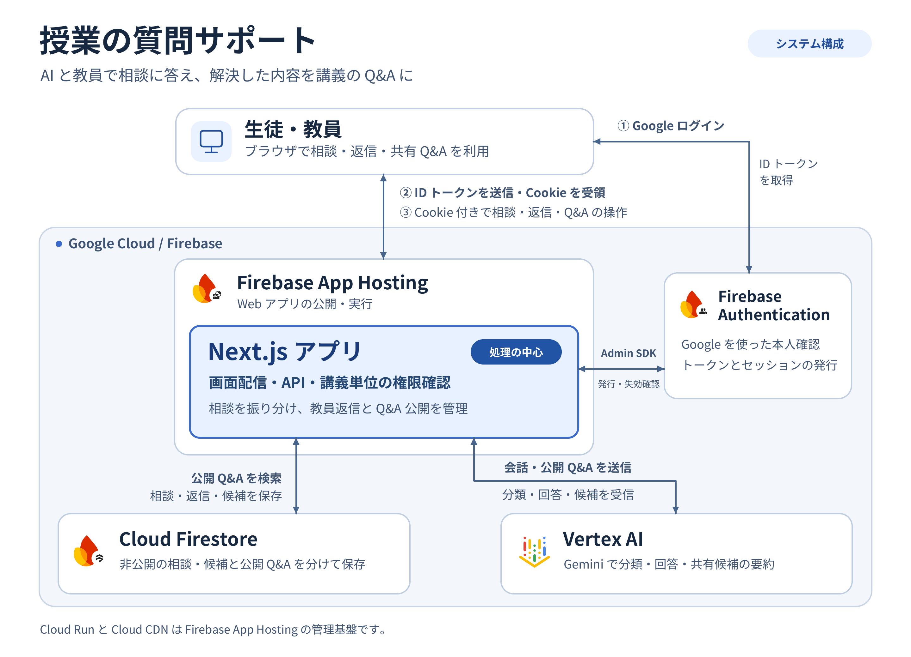

# 授業の質問サポート

生徒の質問に AI（Gemini）がすぐ答え、AI では答えられない質問を担当の先生に引き継ぐ Web アプリです。解決したやり取りは AI が Q&A の案にまとめ、先生が確認したものだけを同じ講義の生徒に共有します。

DevFest GDGoC Japan Hackathon 2026（教育カテゴリ）の提出作品です。

- **デプロイURL**：https://hackathon-app--hackathon-513708.asia-east1.hosted.app
- **対象**：高校生・大学受験生と、その先生。講義ごとに使う仕組みなので、大学の講義や塾・予備校にも使えます

アプリの画面では、授業やクラスの単位を「講義」と呼んでいます。

## 主な機能

**生徒**

- AI とのチャットで質問できる。数式の入力と表示に対応
- 講義で共有された Q&A を根拠に、AI がすぐ答える。回答には参考にした Q&A が表示される
- テストの範囲のように授業ごとに違う質問は、AI が推測せずに先生へ引き継ぐ。「解決しなかった · 先生に相談」で自分から引き継ぐこともできる
- 「解決した」を押すと、AI が共有用の Q&A 案を作って先生に送る
- 「みんなのQ&A」で、共有された Q&A をキーワードとカテゴリで探せる

**先生**

- 「質問対応」：引き継がれた質問を一覧で見て、回答する
- 「Q&A確認」：AI が作った Q&A 案を確認・編集し、共有するか見送るかを決める
- 「共有済みQ&A」：共有中の Q&A を確認し、取り下げる
- 「講義の設定」：カテゴリの追加・名前の変更、参加コードの発行（30分有効）

## Google の技術



| 技術 | 使い方 |
|---|---|
| Vertex AI（Gemini） | 質問のカテゴリ分類、回答と先生に引き継ぐかの判断、解決後の Q&A 案の要約に使う。応答は構造化出力（JSON）で受け取り、型と参照した Q&A を検証してから保存する。モデルは `gemini-3.8-flash` |
| Cloud Firestore | 講義、相談、Q&A 案、共有 Q&A、参加者、通知を保存する。非公開の相談と共有 Q&A は別のコレクションに分ける。回答時は、分類したカテゴリで共有 Q&A を絞り込む |
| Firebase Authentication | Google ログイン（登録済みアカウントのメール／パスワードにも対応）。ID トークンをサーバーで検証し、セッション Cookie に交換する |
| Firebase App Hosting | Next.js の画面と API を実行する。実体は Cloud Run で、インスタンス数は 0〜2 |

Gemini のモデルは、架空の質問50問を4つのモデルに送って比べ、先生に引き継ぐべき質問を見逃さないものを選びました。[モデル比較の結果](docs/hackathon/gemini-model-evaluation-results.md)

## 安全性の設計

- ブラウザから Firestore に直接アクセスしない。権限の確認は `src/server/auth/` にまとめ、サーバーで行う
- 先生かどうかは、講義に登録された確認済みのメールアドレスで判定する。ブラウザから送られた ID や役割は信用しない
- 質問者の名前は担当の先生にだけ返し、ほかの生徒や共有 Q&A には出さない
- API キーやサービスアカウントの鍵はリポジトリに置かない。Firestore と Vertex AI には、App Hosting のサービスアカウントで接続する

## ディレクトリ構成

```text
src/
  app/                  ホーム、ログイン、参加、講義ページ、API の入口
  components/           生徒・教員の画面で使う共通 UI（会話、Markdown・数式の表示など）
  domain/               SDK に依存しない型とデータ契約
  features/
    auth/               ログイン・招待フォーム、ブラウザのセッション表示
    courses/            講義の作成フォーム
    student/            生徒画面と質問の操作
    teacher/            教員画面、返信、Q&A 案・招待の操作
    questions/          共通ストアへの参照
  server/
    auth/               セッションの検証、講義と質問のアクセス制御
    firestore/          Admin SDK、レコード定義と共通ストア
    workflow/           質問の状態遷移と AI 処理の接続
    ai/                 Vertex AI の呼び出し、応答の検証、固定応答
scripts/                検証スクリプト、デモデータの投入、Gemini の評価
docs/                   データ設計、決定ログ、テスト報告、著作物利用記録
```

## ローカルで動かす

Docker Desktop を起動し、VS Code の **Dev Containers: Reopen in Container** でリポジトリを開きます。コンテナには Node.js 24、npm、Firebase CLI、Java 21 が入っています。

```bash
npm ci
cp .env.example .env.local
```

```bash
# ターミナル1
npm run emulators

# ターミナル2
npm run dev
```

アプリは [localhost:3000](http://localhost:3000)、Emulator UI は [localhost:4000](http://localhost:4000) です。ログインは Auth Emulator（[localhost:9099](http://localhost:9099)）を使います。開発中のデータは、Emulator を Ctrl+C で終了すると `.emulator-data/` に保存されます。

Emulator を起動した状態で `npm run seed:demo` を実行すると、デモ用の講義 `math-i`（共有 Q&A、招待、状態ごとの相談）を作ります。表示された参加 URL を開いてログインし、表示された参加コードを入力します。作り直すときは `npm run seed:demo -- --reset` です。

ローカルでは、`AI_MODE` が未設定なら Gemini を呼ばずに固定の応答を返します。実際のモデルを試すときは、`.env.local` に `AI_MODE=vertex` と、`GOOGLE_CLOUD_PROJECT`・`VERTEX_AI_LOCATION`・`GEMINI_MODEL` を設定し、Dev Container の中で ADC（アプリケーションのデフォルト認証情報）を使えるようにします。

## 確認用のコマンド

```bash
npm run lint
npm run typecheck
npm run build
npm run check:rules      # 権限と状態遷移の単体テスト（Emulator 不要）
npm run check:ai         # AI 処理の切り替えと応答の検証（固定応答。Gemini は呼ばない）
npm run check:client     # 画面側の再試行・復帰の処理
npm run check:auth       # Auth Emulator でログインとセッション Cookie（Emulator を止めて実行）
npm run check:firestore  # Firestore・Auth Emulator で権限・状態遷移・競合（Emulator を止めて実行）
```

ブラウザでの通し操作は、初回に `npm exec -- playwright install --with-deps --only-shell chromium` を実行し、Next.js と Emulator を止めてから `npm run check:browser` を実行します。結果は[テスト報告](docs/hackathon/test-report.md)にまとめています。

## App Hosting の設定

- アプリのルートはリポジトリのルート、Node.js は 24
- 環境変数：`GOOGLE_CLOUD_PROJECT`、`VERTEX_AI_LOCATION`（`global`）、`GEMINI_MODEL`（`gemini-3.8-flash`）
- 実行サービスアカウントに `roles/aiplatform.user` を付ける
- ブラウザ用の Firebase の設定は、App Hosting の自動設定を使う
- Firebase Authentication で Google とメール／パスワードのプロバイダを有効にし、承認済みドメインにデプロイ先を追加する
- Firestore のルールとインデックスは `firestore.rules` と `firestore.indexes.json`

## ドキュメント

| ファイル | 内容 |
|---|---|
| [docs/データ設計.md](docs/データ設計.md) | Firestore のデータ設計と、質問の状態遷移 |
| [docs/decisions.md](docs/decisions.md) | 決めたことと、その理由の記録 |
| [docs/hackathon/test-report.md](docs/hackathon/test-report.md) | 提出前のテスト報告 |
| [docs/hackathon/gemini-model-evaluation-results.md](docs/hackathon/gemini-model-evaluation-results.md) | Gemini のモデル比較 |
| [docs/著作物利用.md](docs/著作物利用.md) | 使ったライブラリ・サービス・素材の出典とライセンス |

## ライセンス

[MIT License](LICENSE)。依存ライブラリや素材の出典とライセンスは[著作物利用記録](docs/著作物利用.md)にまとめています。
